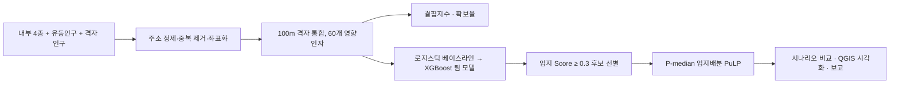
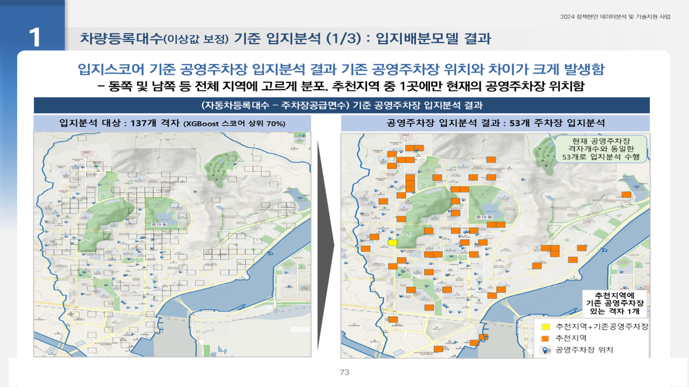
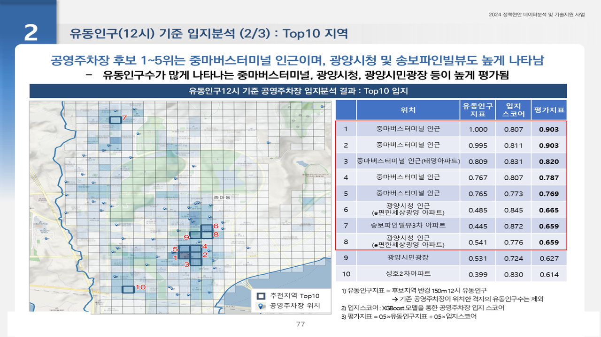

# 광양시 공영주차장 최적입지 선정 분석

2024.07 – 2024.10 · 라임솔루션 (발주처: 전남 광양시청) · 역할: 데이터 정제·격자 통합, 공급·수요 분석, 영향인자 60개 구성, 로지스틱 회귀 베이스라인, P-median 입지배분, QGIS 시각화

## 프로젝트 소개
광양시의 2024년 정책현안 데이터분석 및 기술지원 사업으로, 주차 수요·공급 불균형이 심한 지역에 한정된 예산으로 신규 공영주차장을 어디에 먼저 설치해야 하는지 100m 격자 단위로 분석했다.
팀 구성은 본인 + 사수 1명이며, 이 레포의 코드는 **본인이 작성한 부분**(전처리·수요공급·영향인자·로지스틱 베이스라인·P-median 입지배분)이다.
Random Forest·XGBoost·MLP 모델 비교와 SHAP 해석은 **팀(사수) 수행**이며 코드는 포함하지 않는다.

## 문제 정의
- 배경: 주차 수요·공급 불균형이 심화되고 한정된 예산으로 신규 공영주차장을 설치해야 함
- 질문: 어느 격자(100m)가 공급이 결핍되어 있고, 수요와 이동거리를 함께 고려할 때 어디에 먼저 설치해야 하는가

## 데이터
| 데이터 | 출처 | 규모 | 공개 여부 |
|---|---|---|---|
| 건축물대장, 도로 레이어, 등록차량, 주차장 현황 | 광양시 내부 4종 | 등록차량 96,692건, 공영주차장 237개소(12,241면) | 비공개 (주소 기반) |
| 통신사 유동인구 | 외부 1종 | 시간대별 격자 | 비공개 (계약 데이터) |
| 100m 격자 인구 | 국토부 국토정보플랫폼 | 12개 행정동, 격자 47,422개 | 공공 |

- **원천 데이터는 이 레포에 포함하지 않는다.** 코드가 읽는 파일(xlsx/shp/gpkg/pkl)은 모두 `.gitignore` 대상이다.
- 대신 코드가 기대하는 컬럼 구조를 따르는 **합성 샘플** `data/sample/grid_features_sample.csv`(150행, numpy seed 42 난수)를 제공한다. 실제 분포와 무관하다. 컬럼 설명은 `data/sample/README.md` 참고.

## 분석 방법
1. **데이터 정제** (`src/1.전처리_수요공급분석.py`): 등록차량 96,692건에서 차량번호·주소 기준 중복 3,216건 제거 → 93,477건 좌표화. 주차장·건축물대장 주소 정제 후 100m 격자 매핑
2. **공급·수요 분석** (같은 파일): 행정동별 주차장 확보율, 국토연구원 방식 결핍지수(공급량 0.5 + 접근성 0.5)
3. **영향인자 구성** (`src/2.영향인자.py`): 인구·유동인구·등록차량·주차장·주요시설 등 60개 변수를 격자 내·300m 반경 기준으로 생성
4. **입지 Score** (`src/location_allocation/요인분석.py`): 공영주차장 존재 격자(117개, 1.7%)를 타깃으로 언더샘플링 후 로지스틱 회귀 베이스라인 → 팀에서 RF·XGBoost·MLP 비교
5. **입지배분** (`src/location_allocation/P_median_func.py`): Score 0.3 미만 격자 제외 후 P-median(PuLP)으로 수요·이동거리 총합 최소화
6. **시나리오 비교**: 차량등록 기준 / 이상값 보정(150m 통합) / 유동인구(12시) / 입지스코어 4개 시나리오



## 기술 스택
- 본인: Python, Pandas, GeoPandas, Shapely, Scikit-learn(Logistic Regression, StandardScaler), PuLP(P-median), QGIS, Excel
- 팀: XGBoost, Random Forest, MLP, SHAP

## 결과
- 광양읍 후보 679개 격자 중 **64개**, 중마동 137개 격자 중 **53개** 입지 선정
- 팀 모델(XGBoost, 사수 수행) 검증 정확도 0.9304, 테스트 정확도 0.9601, AUC 0.898 — 타깃 1.7% 불균형이라 Precision은 낮고, Score는 후보 선별용으로 사용
- 통합지표 1순위: 창덕에버빌 2단지 인근 교차로(0.845). 상위 10개 지역 모두 아파트 밀집 지역
- 정책 검토자료(완료보고서 2024.10.17) 광양시청 제출




## 실행 방법
- 환경: Python 3.9, `pandas geopandas shapely scikit-learn pulp statsmodels matplotlib openpyxl`
- 이 스크립트들은 사내 공통 모듈(`config.config_A10`, `utils.functions_utils` 등)에서 경로·로그 설정을 읽도록 작성되어 있으며 해당 모듈은 포함하지 않는다. 실행하려면 파일 상단의 `config_info[...]` 경로 블록을 로컬 경로로 바꾸고 `log.*` 호출을 제거하거나 `print`로 대체해야 한다.
- 실행 순서: `1.전처리_수요공급분석.py` → `2.영향인자.py` → `location_allocation/요인분석.py`(로지스틱 Score·후보 격자 추출) → `location_allocation/P_median_func.py`의 `p_median(factor_df, geo_df, factor_nm, p, out_file_nm)` 호출
- 코드 안의 `C://2024_project//...` 등 하드코딩 경로는 원본 그대로 두었으므로 **환경에 맞게 수정**해야 한다.
- `p-median_common.lp`는 PuLP가 `prob.writeLP()`로 기록한 선형계획 모델 파일(한 번의 실행 결과, 3.2 MB)로 참고용이다.
- 샘플 데이터로 P-median 로직만 확인하려면 `grid_features_sample.csv`의 `x, y`로 `shapely.Point` geometry를 만들어 `geo_df`로, 나머지 컬럼을 `factor_df`로 넘기면 된다.

## 폴더 구조
```
gwangyang-parking-site-selection/
├── README.md
├── .gitignore
├── src/
│   ├── 1.전처리_수요공급분석.py      # 정제·좌표화·확보율·결핍지수
│   ├── 2.영향인자.py                 # 60개 영향인자 생성
│   └── location_allocation/
│       ├── 요인분석.py               # 로지스틱 베이스라인 → Score → 후보 격자
│       ├── P_median_func.py          # P-median (PuLP) 함수
│       └── p-median_common.lp        # PuLP LP 모델 덤프 (참고용)
├── data/sample/
│   ├── grid_features_sample.csv      # 합성 샘플 (150행)
│   └── README.md
└── docs/images/                      # 결과 캡쳐
```

## 참고
- Obsidian 노트: `2024-07_광양시_공영주차장_최적입지`
- 관련 레포: `daejeon-tashu-rebalancing`(같은 시기 라임솔루션 프로젝트)
- 공식 완료보고서(2024.10.17)와 원천 데이터는 발주처 자료로 **비공개**이며 이 레포에 포함하지 않는다.
